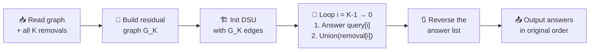
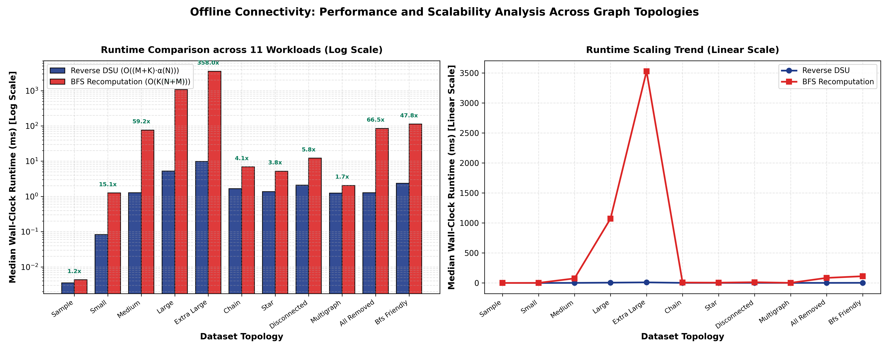
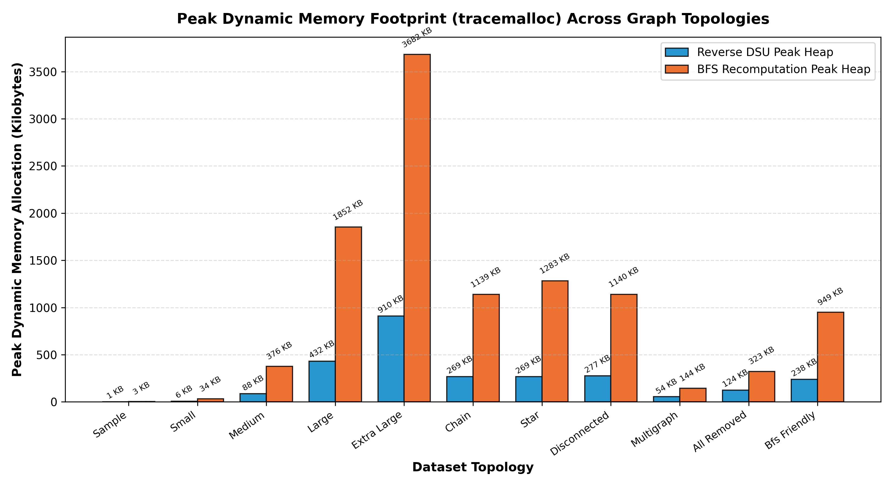

<p align="center">
  <h1 align="center">⚡ Offline Connectivity After Edge Removals</h1>
  <p align="center"><em>Answer connectivity queries on a shrinking multigraph — in near-linear time — by reversing time and turning deletions into unions.</em></p>
</p>

<p align="center">
  
  
  
  
  
</p>

> **Note:** Report and presentation are prepared manually and are not generated by this repository.

---

## 🤔 Why This Problem?

Standard Union-Find (DSU) can **add** edges blazingly fast, but it **cannot delete** them. If someone hands you a graph and says *"remove these edges one by one; after each removal tell me if u and v are still connected"*, a naïve approach rebuilds connectivity from scratch every time — brutally slow on large graphs.

**The trick:** if you know all the removals upfront (offline), **reverse time**. Start from the final graph (after all removals), then replay removals backwards as *additions*. Now DSU works perfectly!

---

## 💡 Worked Example

Consider a small triangle with an extra parallel edge:

```
Graph: 3 vertices, edges = [(0,1), (0,1), (1,2)]

Removals (in order):  Step 1: remove (0,1)    Step 2: remove (1,2)
Queries (after each):  Step 1: "0 ↔ 1 ?"      Step 2: "0 ↔ 2 ?"
```

**Reverse-DSU walkthrough:**

| Phase | Action | DSU State | 
|:---:|:---|:---|
| **Build residual graph** | Remove both edges from initial → residual = `[(0,1)]` | `{0,1}` connected; `2` alone |
| **Step 2 (reversed first)** | Query `0 ↔ 2` → **False** · then restore `(1,2)` | `{0,1,2}` all connected |
| **Step 1 (reversed second)** | Query `0 ↔ 1` → **True** · then restore `(0,1)` | `{0,1,2}` all connected |

Flip the answers back to chronological order → **`[True, False]`** ✅

---

## 🔄 How Reverse Processing Works



---

## 📊 Algorithm Comparison

| | 🟦 Reverse DSU | 🟥 BFS/DFS Recomputation |
|:---|:---|:---|
| **Time Complexity** | O((M + K) · α(N)) ≈ linear | O(K · (N + M)) — quadratic when K ≈ M |
| **Space** | O(N + M) — flat arrays | O(N + M) — nested hash maps + queues |
| **Processing** | Offline (needs all removals upfront) | Online (step-by-step) |
| **Best when** | K is large, graph is dense | Queries are localized, graph is tiny |
| **Observed speedup** | — | **Up to 358×** slower than DSU |

---

## 🚀 Quick Start

```bash
# 1. Clone & enter
git clone https://github.com/Ayusshh020/Offline-Connectivity-DSU.git
cd Offline-Connectivity-DSU

# 2. Install dependencies
pip install -r requirements.txt

# 3. Run on sample dataset
python3 -m src.main --input data/sample.json --algorithm both

# 4. Run all 25 tests + 2,000 fuzz trials
python3 -m unittest discover -s tests -v

# 5. Run the full benchmark suite (11 workloads × 5 runs)
python3 -m src.main --benchmark --repeats 5

# 6. Generate all 11 datasets fresh
python3 -m src.main --generate-data
```

---

## 📁 Project Structure

```
Offline-Connectivity-DSU/
│
├── src/
│   ├── __init__.py            # Package marker
│   ├── dsu.py                 # DSU with iterative path compression & union-by-rank
│   ├── algorithms.py          # Reverse DSU, BFS, DFS, brute-force oracle
│   ├── graph_utils.py         # Edge normalization, multiplicity validation, JSON I/O
│   ├── generate_data.py       # 11 synthetic dataset generators
│   ├── benchmark.py           # Timing + memory profiler + Matplotlib plots
│   └── main.py                # Unified CLI entrypoint
│
├── data/                      # 11 pre-generated JSON datasets
│   ├── sample.json            #   N=5 (tiny demo)
│   ├── small.json             #   N=100,  M=200,   K=80
│   ├── medium.json            #   N=1000, M=3000,  K=1000
│   ├── large.json             #   N=5000, M=15000, K=2500
│   ├── extra_large.json       #   N=10000,M=30000, K=3500
│   ├── chain.json             #   Deep path graph
│   ├── star.json              #   Hub-and-spoke star
│   ├── disconnected.json      #   50 isolated components
│   ├── multigraph.json        #   Dense parallel edges
│   ├── all_removed.json       #   Total destruction (K = M)
│   └── bfs_friendly.json      #   Localized distance-1 queries
│
├── tests/
│   ├── __init__.py
│   └── test_algorithms.py     # 25 unit tests + 2,000 randomized fuzz trials
│
├── results/
│   ├── benchmark_results.csv  # Raw measurements across all 11 workloads
│   ├── runtime_comparison.png # Log + linear runtime plots
│   └── memory_comparison.png  # Peak heap memory bar chart
│
├── README.md
├── requirements.txt           # matplotlib>=3.5.0
└── .gitignore
```

---

## ✨ Features

- **Multigraph support** — parallel edges tracked by multiplicity via `Counter`; one removal deletes exactly one copy
- **Iterative path compression** — no Python recursion-depth crashes, even on 10,000-node chains
- **4 solvers** — Reverse DSU, BFS recomputation, DFS recomputation, and a brute-force oracle
- **Strict validation** — rejects self-loops, out-of-bound vertices, and over-removals with clear error messages
- **25 automated tests** + **2,000 randomized differential fuzz trials** comparing all 4 solvers
- **11 benchmark topologies** — from trivial 5-node graphs to 10,000-node extra-large workloads
- **Automated plots** — high-resolution runtime and memory comparison PNGs via Matplotlib

---

## 📈 Benchmark Results

Measured over **5 repeated runs** per dataset (median runtimes reported):

| Topology | N | M | K | DSU (ms) | BFS (ms) | Speedup | Correct |
|:---|---:|---:|---:|---:|---:|---:|:---:|
| Sample | 5 | 4 | 3 | 0.004 | 0.004 | 1.2× | ✅ |
| Small | 100 | 200 | 80 | 0.083 | 1.249 | **15.1×** | ✅ |
| Medium | 1,000 | 3,000 | 1,000 | 1.278 | 75.716 | **59.2×** | ✅ |
| Large | 5,000 | 15,000 | 2,500 | 5.242 | 1,072.661 | **204.6×** | ✅ |
| Extra Large | 10,000 | 30,000 | 3,500 | 9.852 | 3,526.603 | **358.0×** | ✅ |
| Chain | 4,000 | 3,999 | 1,500 | 1.661 | 6.880 | 4.1× | ✅ |
| Star | 4,000 | 3,999 | 1,500 | 1.363 | 5.160 | 3.8× | ✅ |
| Disconnected | 4,000 | 4,936 | 1,500 | 2.082 | 12.142 | 5.8× | ✅ |
| Multigraph | 500 | 3,000 | 1,200 | 1.234 | 2.045 | 1.7× | ✅ |
| All Removed | 1,000 | 2,000 | 2,000 | 1.273 | 84.604 | **66.5×** | ✅ |
| BFS-Friendly | 3,000 | 6,000 | 1,500 | 2.349 | 112.337 | **47.8×** | ✅ |

> DSU median runtimes, BFS median runtimes, and speedup factors are taken directly from `results/benchmark_results.csv`.

### Runtime Comparison



### Memory Comparison



---

## 📋 Input / Output Format

Inputs are JSON files with 0-based vertex indexing. Parallel edges are allowed:

```json
{
  "n": 3,
  "edges": [[0,1], [0,1], [1,2]],
  "removals": [[0,1], [1,2]],
  "queries": [[0,1], [0,2]]
}
```

| Field | Description |
|:---|:---|
| `n` | Number of vertices (0 to n−1) |
| `edges` | Undirected edges; duplicates allowed (multigraph), self-loops forbidden |
| `removals` | Edges removed in chronological order; each removes exactly one copy |
| `queries` | One connectivity query `[u, v]` asked immediately after each removal |
| **Output** | List of booleans — `True` if connected, `False` otherwise |

---

## ⚠️ Assumptions & Limitations

| Assumption | Detail |
|:---|:---|
| **Multigraph** | Parallel edges are allowed and tracked by multiplicity |
| **No self-loops** | Edges `[u, u]` are rejected with a `ValueError` |
| **Offline only** | All removals and queries must be known in advance |
| **Undirected** | All edges are bidirectional |
| **0-indexed** | Vertices are numbered 0 to n−1 |

---

## 🛠️ Technologies

- **Python 3.10+** (tested on Python 3.14.0)
- **Standard Library**: `collections.Counter`, `collections.deque`, `json`, `argparse`, `time`, `tracemalloc`, `unittest`, `statistics`, `pathlib`, `random`
- **Visualization**: `matplotlib` (log/linear runtime plots, memory bar charts)

---

## 📚 References

1. Tarjan, R. E. (1975). *Efficiency of a good but not linear set union algorithm*. JACM, 22(2), 215–225.
2. Cormen, T. H., et al. (2022). *Introduction to Algorithms* (4th ed.). MIT Press. Chapter 19: Disjoint Sets.
3. Holm, J., de Lichtenberg, K., & Thorup, M. (2001). *Poly-logarithmic deterministic fully-dynamic algorithms for connectivity*. JACM, 48(4), 723–760.
4. Galler, B. A., & Fischer, M. J. (1964). *An improved equivalence algorithm*. CACM, 7(5), 301–303.

---

## 👤 Authors

| Name | Role |
|:---|:---|
| *Your Name Here* | Developer & Investigator |

---

<p align="center"><sub>Data Structures and Algorithms II — Mini Project</sub></p>
